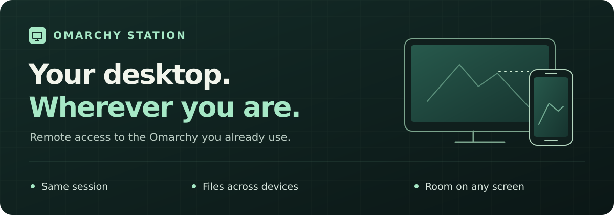

# Omarchy Station



**Your desktop. Your apps. Pick up where you left off.**

An RDP server for [Omarchy](https://omarchy.org/) and Hyprland. Connect from a
Mac, laptop or phone to the desktop you already use. Keep your apps running,
bring files across and make room when you move to a smaller screen.

[](https://github.com/hudrucan/omastation/actions/workflows/ci.yml)
[](LICENSE)

[Get started](#get-started) · [Everyday use](#everyday-use) ·
[Configure](#configure) · [Build](#development) ·
[Report an issue](https://github.com/hudrucan/omastation/issues)

The command, package and services are still named **`omastation`**. Existing
installations keep their configuration and credentials.

## One desktop, wherever you connect

| What you want to do | What Station handles |
| --- | --- |
| Leave your desk and keep working | Use the same apps and workspaces. Disconnecting locks the desktop and leaves your apps running. |
| Bring a project over from your Mac | Copy files or a whole folder in Finder, then paste into Files on the remote desktop. |
| Move from a large display to a phone | Floating windows on remote outputs move into view and shrink to fit the smaller work area. |
| Type, scroll and move windows | GPU capture and negotiated H.264 encoding, with input processed during hardware encoding waits. |
| Connect before anyone logs in | Optional on-demand login starts or reuses your desktop after authentication. |
| Keep the physical desk private | Remote takeover turns off physical monitors and fences local input; the desktop locks before local access returns. |

Uses the distribution's **stock Hyprland**. Cursor handling lives in the native
plugin; there is no compositor patch to maintain.

<details>
<summary>Earlier RDP connection sample</summary>

[Watch the sample recording](docs/assets/demo.mp4). It shows a real localhost
RDP connection to an isolated Hyprland desktop through FreeRDP, with sample
windows. The recording is 12 fps and is not a performance benchmark.

</details>

## Get started

### 1. Install on Omarchy

```sh
git clone https://github.com/hudrucan/omastation.git
cd omastation
./install-omarchy
```

The installer prepares dependencies and the pinned Zig toolchain, then builds
and installs an Arch package through pacman. Installation does not enable remote
access automatically.

The package targets **x86-64 Linux with Hyprland**. GPU acceleration needs
compatible Vulkan and VA-API drivers; OpenH264 provides optional software H.264.

### 2. Enable access to your current desktop

Run these commands from an existing Hyprland session:

```sh
omastation passwd
sudo systemctl enable --now "omastation-helper@$(id -u)"
systemctl --user enable --now omastation
```

Use your Linux login password when saving the RDP credentials.

### 3. Connect

Open an RDP client such as **Windows App** on your Mac or phone. Add this
machine's address, use port **3389**, and sign in with your Linux user name and
password. Connections use TLS, NLA and a PAM password check by default.

If you use UFW, the package includes a profile:

```sh
sudo ufw allow omastation
```

Want to connect before the desktop starts? Follow [on-demand login](docs/login.md).
The desktop and login listeners share the same port; enable one mode at a time.

## Everyday use

### Copy across devices

Copy text or images in your client and paste into a compatible remote app.
For files, copy files or folders in Finder/Explorer, then paste into **Files** on
the remote desktop. Folder contents and empty subfolders are preserved.

File transfers require a client that supports clipboard file streaming. Copied
image content and copied image files use different clipboard formats. Windows
App on macOS is used for manual testing; available formats depend on the client.

### Make a smaller screen usable

Client size, scale and monitor layout are negotiated on connection. After a
display change, floating windows on remote outputs are brought into the work
area and shrunk where they exceed it, including windows on inactive workspaces.

Apps with a larger minimum size keep their top-left corner reachable. Tiled and
fullscreen windows follow Hyprland's layout. Growing the display does not
restore earlier window sizes.

On macOS/iOS clients, **Option/Alt + left drag** moves a window and
**Option/Alt + right drag** resizes it. Hyprland's Super + drag bindings remain
available. Browser tabs use the Linux app's shortcuts: Ctrl + W closes a tab;
Station does not remap Super + W.

### Disconnect and come back

Closing the RDP connection locks the desktop without logging you out. Your apps
stay open for the next connection. This does not prevent the machine from
sleeping, rebooting or being logged out separately.

Audio playback, microphone, redirected drives, RemoteApp, touch and pen are also
supported where the client provides them. Graphics and clipboard capabilities
are negotiated per connection.

## Configure

`omastation --help` lists server options. The packaged desktop service runs
`omastation --desktop`; the optional login service runs `omastation --login`.

| Option | What it controls |
| --- | --- |
| `--frame-interval 16` | Target 16 ms between frames; default is 31 ms. Actual rate depends on encoding, client and connection. |
| `--no-gpu-capture` | Use shared-memory capture and CPU change detection for troubleshooting. |
| `--h264-encoder auto\|vaapi\|software` | Select automatic, VA-API hardware or OpenH264 software encoding. |
| `--alt-drag auto\|on\|off` | Control Option/Alt mouse bindings; automatic for macOS/iOS clients. |

These are server flags. To use them in a packaged service, run
`systemctl --user edit omastation` or `systemctl --user edit omastation-login`.
Clear the inherited `ExecStart` before adding a replacement; keep the appropriate
`--desktop` or `--login` mode and any existing custom flags. Restarting the
listener disconnects the current RDP client.

<details>
<summary><strong>Graphics and cursors</strong></summary>

Desktop capture uses DMA-BUF and Vulkan when supported, with shared-memory
fallback. Changes are detected on the GPU. Eligible H.264 updates write selected
blocks directly into the encoder's NV12 surfaces; other updates read back the
pixels they need. VA-API supports AVC420/AVC444, while OpenH264 software encoding
supports AVC420. The client must negotiate the corresponding codec.

When Wayland cursor capture returns empty images, the native plugin can supply
the actual cursor bitmap from CPU memory. Snapshots are bounded to 256×256
pixels and unchanged images are cached. GPU-only cursor surfaces fall back to
painting the pointer into desktop frames, with a transparent client pointer to
avoid double cursors. The plugin also guards capture requests against removed
outputs.

</details>

## Update and troubleshoot

From your checkout:

```sh
git pull --ff-only
./install-omarchy
```

The native plugin is compiled against the installed Hyprland headers and build
ID. Its package hook rebuilds it after Hyprland upgrades. Log out and back in
after an upgrade so the running compositor matches the installed files.

<details>
<summary><strong>Service logs and graphics troubleshooting</strong></summary>

```sh
journalctl --user -u omastation
journalctl -u "omastation-helper@$(id -u)"
```

For on-demand login, use `journalctl --user -u omastation-login`.
For graphics problems, compare a connection with `--no-gpu-capture` and include
the relevant service log in your report.

</details>

## Development

The server is written in Zig, with a C++ Hyprland plugin. Build commands live at
the repository root. Generated files stay outside the source checkout:

| Files | Location |
| --- | --- |
| Builds and build caches | `~/.cache/omastation` |
| Built packages | `~/.local/share/omastation/packages` |

```sh
mise trust
mise install
make build
make check
```

`make build` builds the server. `make check` also compiles the plugin for the
installed Hyprland, checks Zig formatting and shell syntax, and runs Zig unit
tests and desktop-start integration tests without changing live services.
Use `make test-cursor` for the isolated compositor cursor test.

See [building and packaging](docs/build.md) for dependencies, cache locations and
commands. `make package` includes current source changes without requiring a
commit; `make install` installs the resulting package.

## Contributing and credits

[Open an issue](https://github.com/hudrucan/omastation/issues) with your Station
package version, Omarchy/Hyprland and RDP client versions, reproduction steps,
and relevant logs with private information removed. Focused pull requests are
welcome. Run `make check` before submitting code; display and client changes
also need a live session check.

Omarchy Station is developed from
[realazizk/omastation](https://github.com/realazizk/omastation), including its
Vulkan capture and H.264 pipeline. Fork additions include on-demand login,
macOS clipboard file/folder support, input servicing during hardware encode
waits, floating-window recovery, stock-Hyprland cursor handling and the external
build/package workflow.

[MIT license](LICENSE). Original copyright notices are retained.
