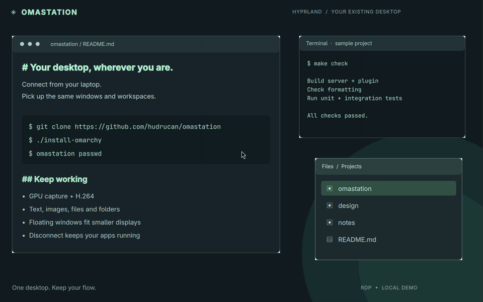

# Omastation

**Your Omarchy desktop, wherever you connect.**

[](https://github.com/hudrucan/omastation/actions/workflows/ci.yml)
[](LICENSE)

An RDP server for [Omarchy](https://omarchy.org/) and Hyprland. Connect from your
Mac, laptop or phone and pick up the same apps, windows and workspaces.



*A real localhost RDP connection to an isolated Hyprland desktop, viewed through
FreeRDP with sample demo windows. Recorded at 12 fps for a lightweight preview.
[Video](docs/assets/demo.mp4)*

[Install](#install) · [Connect](#connect) · [Features](#features) ·
[Configure](#configure) · [Develop](#development)

## Features

- **Pick up where you left off.** Your workspaces move to remote outputs and
  return on disconnect. Closing the RDP client locks the desktop and keeps your
  apps running.
- **Move between screens.** Client size, scale and monitor layout are negotiated.
  Floating windows are brought back into view when you switch to a smaller
  display, including windows on inactive workspaces.
- **Bring your clipboard.** Copy text, images, files and whole folders between
  client and desktop. macOS Finder file transfers work with Windows App.
- **Keep typing and moving.** Keyboard and mouse input is processed while
  hardware encoding is in progress. GPU capture, H.264 and lossless refinement
  adapt updates to the screen and the client's capabilities.
- **Keep the physical desk private.** Remote takeover turns off physical monitors
  and fences local input. The desktop locks before local access is restored.
- **Connect before the desktop starts.** Optional [on-demand login](docs/login.md)
  authenticates you first, then starts or reuses your desktop.

Audio playback, microphone, redirected drives, RemoteApp, touch and pen are also
supported where the client provides them. Clipboard and graphics formats are
negotiated per connection. Windows App on macOS is used for manual testing;
client capabilities and settings affect which features are available.

## Install

On Omarchy:

```sh
git clone https://github.com/hudrucan/omastation.git
cd omastation
./install-omarchy
```

The installer installs dependencies through Omarchy, sets up the pinned Zig
toolchain with mise, then builds and installs an Arch package through pacman.
The package targets **x86-64 Linux with Hyprland**. GPU acceleration needs a
compatible Vulkan/VA-API driver; OpenH264 provides optional software H.264.

Builds stay under `~/.cache/omastation`; packages stay under
`~/.local/share/omastation/packages`. Generated build files stay outside the checkout.

Omastation installs to `/usr` because its helper, systemd units and plugin rebuild
hook use system paths. Installing the package does not enable remote access;
follow the steps below.

## Connect

From an existing Hyprland session:

```sh
omastation passwd
sudo systemctl enable --now "omastation-helper@$(id -u)"
systemctl --user enable --now omastation
```

Use your Linux login password when saving the RDP credentials. Connect an RDP
client to this machine on port **3389**, using your Linux user name and password.
Connections use TLS, NLA and a PAM password check by default. If you use UFW,
the package provides a profile:

```sh
sudo ufw allow omastation
```

These commands enable access to an **existing Hyprland session**. For remote
login before the desktop starts, follow [on-demand login](docs/login.md) instead.
The two listeners share the same port; enable one mode at a time.

### Clipboard and window controls

For clipboard file transfers, copy files or folders in Finder/Explorer and paste
them into Files on the remote desktop. Folder contents and empty subfolders are
preserved. The client must support clipboard file streaming; copied image data
uses the separate image clipboard formats.

On macOS/iOS clients, **Option/Alt + left drag** moves a window and
**Option/Alt + right drag** resizes it. These supplement Hyprland's Super + drag
bindings. Omastation does not remap Super + W to Ctrl + W; browser tab shortcuts
follow the Linux application's bindings.

## Configure

`omastation --help` lists server options. The packaged service runs
`omastation --desktop`; the optional login service runs `omastation --login`.
Client monitor size, scale and layout are negotiated on connection.

After a display change, floating windows on the remote outputs are moved into
the work area and shrunk only where they exceed it, including windows on inactive
workspaces. Applications that require a larger minimum size keep their top-left
corner reachable. Tiled and fullscreen windows follow Hyprland's layout. Growing
the display does not restore earlier window sizes.

| Option | What it controls |
| --- | --- |
| `--frame-interval 16` | Target 16 ms between frames; default is 31 ms. Actual rate depends on encode time, client and connection. |
| `--no-gpu-capture` | Force shared-memory capture and CPU change detection for troubleshooting. |
| `--h264-encoder auto\|vaapi\|software` | Select automatic, VA-API hardware or OpenH264 software encoding. |
| `--alt-drag auto\|on\|off` | Control the Option/Alt mouse bindings; automatic for macOS/iOS clients. |

These are server flags, not persistent settings. To use them in a packaged
service, add them to its `ExecStart` with `systemctl --user edit omastation`
(or `omastation-login` for on-demand login), keeping the appropriate
`--desktop` or `--login` mode. Clear the inherited `ExecStart` before setting a
replacement, and preserve any existing custom flags. Restarting the listener
disconnects the current RDP client.

The native plugin is compiled against the installed Hyprland headers and build
ID. Its package hook rebuilds it after Hyprland upgrades. Log in again after an
upgrade so the running compositor matches the installed files.

<details>
<summary><strong>Graphics pipeline and optional compositor patches</strong></summary>

Desktop capture uses DMA-BUF and Vulkan when supported, with shared-memory
fallback. Changes are detected on the GPU. Eligible H.264 updates write selected
blocks directly into the encoder's NV12 surfaces; other updates read back the
pixels they need. VA-API supports AVC420/AVC444, while OpenH264 software encoding
supports AVC420. The client must negotiate the corresponding codec.

The separate patched Hyprland package includes cursor-image capture fixes and
capture-lifecycle fixes for removed outputs. Without the cursor fix, Omastation
can paint the pointer into desktop frames.

```sh
make hyprland-package MAKEPKG_FLAGS=--install
```

This replaces the installed compositor with the version in
`packaging/hyprland/PKGBUILD`. Log out and back in afterwards. A later Arch
Hyprland upgrade can replace these patches. Building or updating Omastation
does not apply these compositor patches.

</details>

<details>
<summary><strong>Update and troubleshoot</strong></summary>

From your checkout:

```sh
git pull --ff-only
./install-omarchy
```

Inspect the active service:

```sh
journalctl --user -u omastation
journalctl -u "omastation-helper@$(id -u)"
```

For on-demand login, use `journalctl --user -u omastation-login`.
If the desktop was already running during a Hyprland upgrade, log out and back
in so its build matches the plugin. For graphics problems, compare a connection
with `--no-gpu-capture` and include the relevant service log in your report.

</details>

## Development

The server is written in Zig, with a C++ Hyprland plugin. Build/check commands
live at the repository root and generated files stay outside the source checkout.

```sh
mise trust
mise install
make build
make check
```

`make build` builds the server. `make check` also compiles the plugin for the
installed Hyprland, checks Zig formatting and shell syntax, and runs Zig unit
tests and the desktop-start integration tests without changing live services.
Use `make plugin`, `make bench`, `make package` or `make install` for those tasks.

See [building and packaging](docs/build.md) for dependencies, cache locations,
parallelism and package snapshots. `make package` includes current source changes;
you do not need to commit them first.

## Contributing

Bug reports and focused pull requests are welcome. [Open an issue](https://github.com/hudrucan/omastation/issues)
with your Omastation, Omarchy/Hyprland and RDP client versions, steps to reproduce,
and relevant logs with private information removed. Run `make check` before
submitting code; display and client changes also need a live session check.

This fork builds on [realazizk/omastation](https://github.com/realazizk/omastation),
including its Vulkan capture and H.264 pipeline. Fork additions include on-demand
login, macOS clipboard file/folder support, input servicing during hardware
encode waits, floating-window recovery and the external build/package workflow.
Original MIT copyright is retained.

[MIT license](LICENSE)
